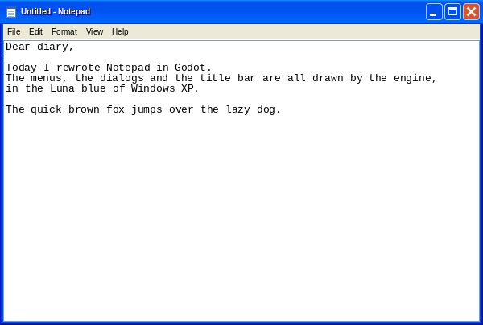
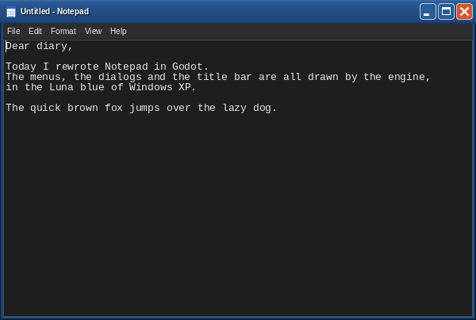

# XP Notepad

An unofficial recreation of Windows XP Notepad (Luna, blue), written in Godot 4 with GDScript.
There is no Electron, no Flutter, no WebView and no HTML or CSS. The window, the menus, the
dialogs and the status bar are drawn by the engine, as one native binary.

**Status.** Version 0.2.0 is a rewrite of the Flutter version (0.1.x) in Godot 4.7.2. It was
verified on Linux (x86-64) only: the test suite runs headless, the app was run under a virtual
display, and the Linux and Windows x64 exports were built. The Windows build was not run, macOS was
not built, no screen reader has been tried and the CI workflows have never run. Known differences
from the Flutter version and from XP are listed below.

## Screenshots

Light mode:



Dark mode:



Both were captured on Linux with `tools/shoot.sh`, from the running app.

## Downloads

Nothing from this version is published yet. The earlier
[v0.1.1 pre-release](https://github.com/goshitsarch-eng/notepad/releases/tag/v0.1.1) is the Flutter
version, an arm64 Flatpak. To use 0.2.0, build it from source (below). `release.yml` is set up to
build a Linux tarball, a Flatpak and a Windows installer for each architecture when a version tag is
pushed; it has not run, so treat those files as untried until a release exists. The files are not
code-signed, so Windows may show a SmartScreen warning.

## Run

Install Godot 4.7.2 (the standard build, not .NET). `tools/install_godot.sh <folder>` downloads it
from the official release page and checks it against the SHA-512 sums in `tools/godot-4.7.2.sha512`
(`tools/install_godot.ps1` does the same on Windows). Then, from the project folder:

```sh
godot --headless --path . --import   # once, so the script classes are registered
godot --path .
```

A file can be passed after `--`: `godot --path . -- notes.txt`.

## Build

The export presets are in `export_presets.cfg` (Linux x86-64 and arm64, Windows x64 and arm64). They
need the export templates for 4.7.2; `tools/install_godot.sh <folder> --templates` fetches them.

```sh
godot --headless --path . --export-release "Linux x86_64" build/xp_notepad
```

The result is one self-contained executable (about 70 MB, because it carries the engine). The
project settings, the presets and the packaging files in `packaging/` (Flatpak, Inno Setup) all say
version 0.2.0.

## Test

```sh
tools/run_tests.sh                       # everything
tools/run_tests.sh --file=large_document # one file, matched by name
tools/run_tests.sh --filter=undo         # tests whose name contains the text
tools/run_tests.sh --list
```

Set `GODOT` to the executable if it is not `godot` on the path. The suite runs headless and holds
about 430 tests: the domain and data layers, the view model, the screen driven with simulated mouse
and keyboard input, the dialogs, large-document editing (including a seeded fuzz test against a plain
string), and the accessibility description of every control. Four tests check file permissions and
skip themselves when run as root.

It is a port of the 518 Dart tests of the Flutter version. Tests of that version that were not ported
are named in the header of the file that replaces them: the golden image comparisons, which became
checks of layout and colour, the Dart-specific text scanning helpers, and the semantics tree checks,
which became `test/ui/test_accessibility.gd`.

`tools/shoot.sh <scenario> <out.png>` saves a screenshot of a named state under Xvfb (scenarios are
listed in `tools/shoot.gd`), and `tools/bench_large.gd` measures large documents.

## What it does

- **Window.** Caption with minimize, maximize and close buttons; drag the caption to move;
  resize from any edge or corner. Alt+Space, a click on the caption icon or a right click on the
  caption opens the window menu (Restore, Minimize, Maximize, Close). The window cannot be smaller
  than 400 × 310. The title follows the document: `notes.txt - Notepad`, or `Untitled - Notepad`.
- **Menus.** File, Edit, Format, View and Help, in XP's order, with shortcuts, Alt mnemonics and
  keyboard navigation.
- **Editing.** Undo, cut, copy, paste, delete, select all, Find, Find Next, Replace, Replace All,
  Go To, and Time/Date (`3:31 PM 10/7/2026`). Tab inserts a tab character. A document of more than
  128 thousand characters is edited through a window of its text, which keeps typing quick however
  large the file is (see Large documents).
- **Files.** Open and Save As in an XP-style dialog. ANSI (Windows-1252), Unicode (UTF-16 LE),
  Unicode big endian and UTF-8, with byte order marks where XP writes them and CRLF line endings on
  disk. A byte order mark says what a file is. Without one, UTF-16 is recognised by its zero bytes
  (only when the other bytes look like text), valid UTF-8 is read as UTF-8 and the rest as ANSI. The
  Open dialog's Encoding list reads a file as a chosen encoding instead. Saving text that ANSI cannot
  hold asks first. Files over 64 MB are refused, and files over 16 million characters ask first.
  A save writes a temporary file and renames it over the target, and follows a symbolic link. When a
  file cannot be opened or saved, the message gives the reason the system reported.
- **Printing.** Page Setup (header, footer, margins in inches), then Print, which lays the text out
  as a PDF and opens it in the system's PDF viewer, where you print it. Headers and footers accept
  `&f` (file name), `&p` (page), `&d` (date), `&t` (time), `&l`, `&c` and `&r` (alignment) and `&&`.
- **Remembered between runs.** Word wrap, status bar, dark mode, font, page setup, the normal
  window size and the last folder.
- **Screen readers.** Menus, buttons, fields, check boxes, radio buttons, lists, dialogs and the
  status bar give assistive technology a name, a role and a state, through Godot's AccessKit
  support, and the window behind a dialog is hidden from it.

The handbook (`docs/handbook/index.html`) describes each feature with its keyboard shortcut and its
limits. It works straight from disk: no server and no internet connection.

## Settings

Settings are JSON, in the same place and with the same keys as the Flutter version, so an existing
file keeps working. On Linux they are in `$XDG_CONFIG_HOME/xp_notepad/settings.json`, or
`~/.config/xp_notepad/settings.json` when `XDG_CONFIG_HOME` is unset, empty or not an absolute path.
On Windows they are in `%APPDATA%\xp_notepad\settings.json` (not verified). With no usable folder,
settings are not kept. A damaged value falls back to its default. The file is replaced through a
temporary file, so a crash cannot leave half of it. To reset the settings, close the app and delete
the file.

## Large documents

Godot's text control shapes the whole text before it shows any of it, so a 1 MB document takes
about 2.5 s to open and 277 MB of memory, and a 5 MB document 9 s and 1.2 GB. A document of at least
128 thousand characters is therefore edited through a window: the control holds the lines around what
is on screen, a few hundred lines, and a scroll bar for the whole document stands in for its own.
The whole text is kept in one place for everything else (save, print, Find, Replace All, Go To, the
status bar), and edits made in the window are written into it. Undo works on the whole document,
Select All and Ctrl+Home and Ctrl+End reach the ends of it, and a key typed while the caret is out of
sight scrolls back to it first.

Measured with `tools/bench_large.gd` under Xvfb with software rendering (so absolute times will
differ), word wrap on:

| Document | Open | Memory | Typed character | Jump or Select All |
|---|---|---|---|---|
| 1 MB | 45 ms | 61 MB | about 33 ms | 55–115 ms |
| 5 MB | 63 ms | 95 MB | about 33 ms | 55–115 ms |
| 20 MB | 138 ms | 222 MB | about 33 ms | 55–142 ms |
| 60 MB | 347 ms | 558 MB | about 33 ms | 55–142 ms |

A typed character costs two frames at every size. Building the whole text of a 60 MB document, as a
save or a Find does, takes about 2.1 s and is then kept until the next edit.

## Known issues

- **Windows and macOS are unverified.** The Windows x64 export was built and its executable checked
  (a PE file with the right machine type and version information), but it was not run. macOS has a
  `packaging/macos/AppIcon.icns` and no export preset. The font lists name Windows fonts first and
  have not been tried there.
- **No screen reader has been tried.** The descriptions are tested as what each control reports;
  how a particular reader presents them is not. For a large document the editor's text is the window
  of lines, so a screen reader is told only those.
- **CI has never run.** `ci.yml` runs the tests and an export smoke test on every pull request and on
  pushes to `main`; `release.yml` builds the downloads when a version tag is pushed.
- **Limits of large documents.** The window holds whole lines, so a line of many tens of thousands of
  characters is laid out whole, and a file made of enormous lines (minified JSON, say) is still slow
  to edit. With word wrap on, the size and place of the scroll bar's thumb are estimates, because
  lines wrap to different heights. The window does not move while a mouse button is held down in the
  text. UTF-16 text in Chinese, Japanese or Korean without a byte order mark has too few zero bytes to
  be recognised: choose Unicode in the Open dialog.

## Architecture

```
project.godot, export_presets.cfg
src/
  main.gd, main.tscn      start-up: settings, window size, scale, the screen
  config/                 app version (read from project.godot) and the object graph
  domain/                 settings models, text search, metrics, Time/Date, header and footer
                          codes; plain GDScript with no engine nodes
  data/                   documents (encoding, atomic save), settings, file listing, printing
                          (a PDF), window control, clipboard
  ui/
    theme/                Luna palette, gradients, metrics, fonts, the shared Theme
    core/                 the XP controls, drawn in _draw(): frame, caption, menus, buttons,
                          check and radio boxes, lists, combo box, and the accessibility layer
    notepad/
      notepad_view_model.gd   state and commands; no nodes
      notepad_screen.gd       window layout, keyboard and focus
      notepad_menus.gd        menu definitions, bound to the view model
      xp_text_edit.gd         the engine's TextEdit with a document API, and the windowed mode
      large_document.gd, edit_history.gd   the window of lines and its undo list
      dialogs/                Find, Go To, Font, Page Setup, Help, About, Open/Save, messages
test/                     the suite (test/run_tests.gd is the runner, test/support the fakes)
tools/                    test runner, Godot installer, screenshot and benchmark scripts
packaging/                Flatpak, Inno Setup (Windows), icons
docs/handbook/            the HTML handbook
```

The view model is a `RefCounted` object that emits `changed`, and the screen redraws from it. The
repositories and services are replaced by fakes in the tests, which build the whole screen on them
and drive it with simulated input. Files over 512 KB are read and written on a worker thread, a file
is read in chunks and refused past 64 MB so a device such as `/dev/zero` cannot exhaust memory, and a
dialog that is ready while another is open waits its turn. The renderer is the compatibility one, the
window is borderless, and the app idles when nothing changes.

## Known differences from stock XP Notepad and from the Flutter version

- **Dialogs are drawn inside the window**, not as separate windows. They are modal, except Find and
  Replace, which are modeless.
- **Printing** makes a PDF and opens it in the system viewer. There is no print dialog of the app's
  own, and no check that a viewer exists beyond the system's answer.
- **Text.** Godot strings cannot hold a NUL, so a NUL in a file is shown as a space and saved as one,
  and a lone UTF-16 surrogate becomes U+FFFD.
- **Fonts.** Tahoma, Trebuchet MS and Lucida Console are used where installed, and the engine's
  fallback fonts where not. Sizes are whole pixels, so the editor's 10 pt line is 13 px, not 13.33.
  A tab is eight columns wide.
- **Open and Save As** have no "Places" bar.
- **Help Topics** lists the keyboard shortcuts in a dialog. XP opens its help file.

Menu and most dialog wording and the default settings (word wrap on, Lucida Console 10pt) are taken
from Wine's Notepad, which reimplements Windows Notepad. The Luna colours, frame bands, caption
gradient, 19px menu bar, 17px scroll bars and 13px editor line pitch come from the Luna theme and the
measured reference used by the earlier clone. The Page Setup margins, the save-changes prompt, the
"Cannot find" message and the underline-on-Alt default are from memory of XP, so check them against a
real XP install. No side-by-side screenshot comparison was made.

## Licence

This project is an unofficial recreation and is not affiliated with Microsoft. The XP look is
reproduced from measurements and published interface details. No Microsoft icons, bitmaps or
branding are used.

The project's own code is licensed under the GNU General Public License, version 3. The full text is
in the `LICENSE` file. Godot is licensed under the MIT licence, and its licence text is part of the
engine's own notices.
